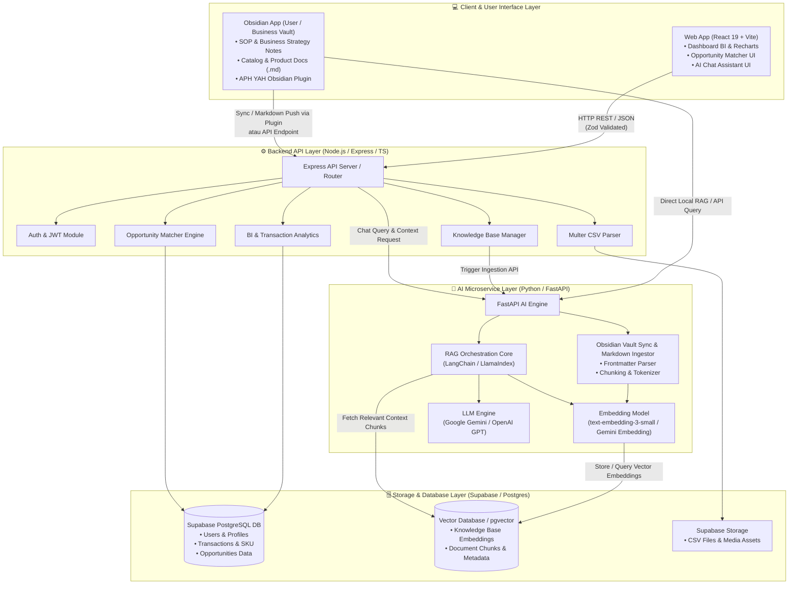
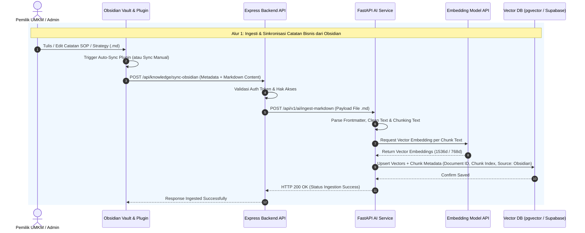
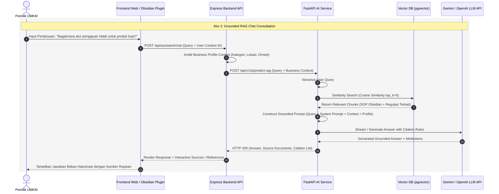

# 🏛️ Arsitektur Sistem & Integrasi AI (APH YAH Platform)

Dokumen ini berisi rancangan arsitektur teknis terintegrasi antara **Frontend Web**, **Backend API**, **AI Microservice (RAG Engine)**, dan **Integrasi Obsidian Vault** untuk platform kecerdasan bisnis UMKM.

---

## 1. High-Level Architecture Diagram

Diagram berikut menggambarkan interaksi antara komponen layer Frontend, Obsidian Vault, Backend Gateway, AI Service, dan Database/Vector Store.

---

## 2. Diagram Integrasi Obsidian Vault (Markdown to RAG Knowledge Base)

Obsidian berfungsi sebagai pencatat strategi bisnis, SOP, dan catatan operasional UMKM. Alur ingesti data dari Obsidian ke RAG Engine digambarkan pada diagram urutan (Sequence Diagram) di bawah ini:

---

## 3. Diagram Alur Tanya Jawab AI Assistant (Grounded RAG Flow)

Berikut alur interaksi user ketika melakukan tanya-jawab bisnis via Web Client atau Obsidian Plugin:

---

## 4. Rincian Peran Komponen Arsitektur

| Layer | Komponen Utama | Teknologi | Peran & Tanggung Jawab Utama |
| :--- | :--- | :--- | :--- |
| **Frontend Web** | Dashboard & Analytics UI | React 19, Vite, Tailwind CSS v4, Recharts | Menampilkan visualisasi omset BI, rekomendasi peluang, dan antarmuka AI Chat Assistant. |
| **Obsidian Integration** | APH YAH Obsidian Plugin | Markdown, TypeScript, Obsidian API | Menghubungkan vault catatan bisnis lokal pengguna secara langsung ke pipeline Knowledge Base RAG. |
| **Backend API** | Business & API Gateway | Node.js, Express, TypeScript, Zod | Mengelola autentikasi JWT, validasi request, logika BI, opportunity matching, serta orkestrasi endpoint. |
| **AI Microservice** | RAG Engine & Model Processor | Python, FastAPI, LangChain/LlamaIndex | Memproses ingesti markdown Obsidian, chunking, ekstraksi embedding, similarity search, dan generasi jawaban LLM. |
| **Database & Vector Store** | Relational & Vector DB | Supabase PostgreSQL + pgvector | Menyimpan data transaksi relational 17 tabel serta vektor embedding dokumen bisnis untuk pencarian pencocokan semantik. |

---

## 5. Fitur Unggulan Integrasi Obsidian dengan AI

1. **Seamless Markdown Knowledge Ingestion**: Catatan SOP, formula resep, daftar harga, dan dokumen strategi bisnis di Obsidian langsung dapat diindeks menjadi Knowledge Base AI.
2. **Context-Aware RAG**: Pertanyaan pengguna tidak hanya dijawab menggunakan LLM umum, melainkan dicocokkan terlebih dahulu dengan konteks catatan pribadi di Obsidian Vault dan profil usaha.
3. **Anti-Hallucination Guardrails**: Jawaban AI wajib memberikan atribut/sitasi (*Sources*) yang merujuk pada catatan Obsidian atau regulasi resmi.
4. **Bi-directional Knowledge Flow**:
   - **Push**: Catatan di Obsidian disinkronkan ke AI Knowledge Base.
   - **Query**: Obsidian Plugin dapat mengeksekusi AI Query langsung di dalam lingkungan editor Obsidian.
