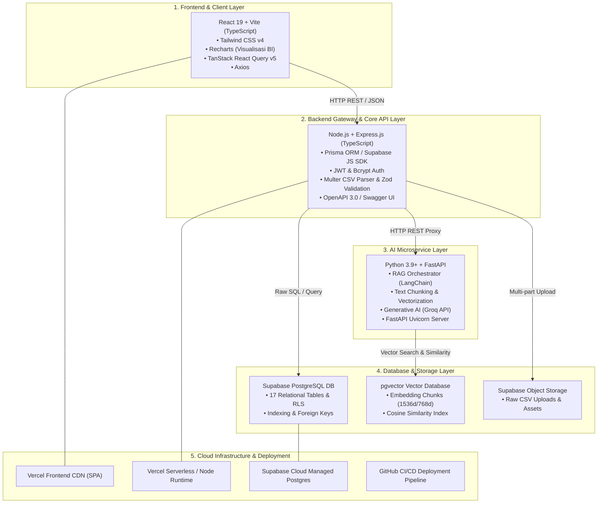
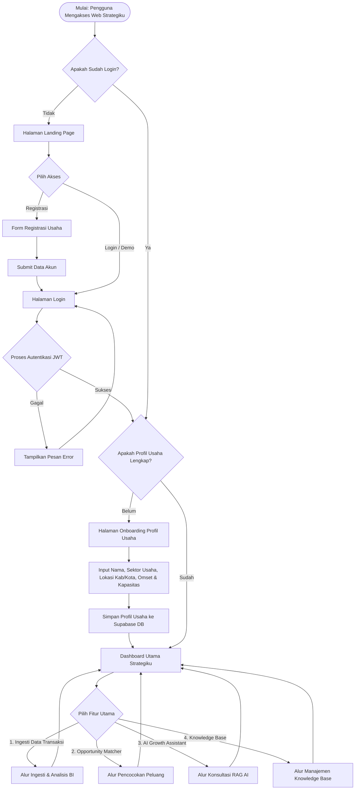
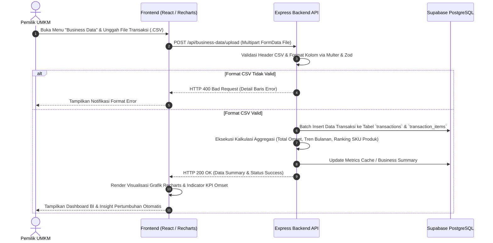
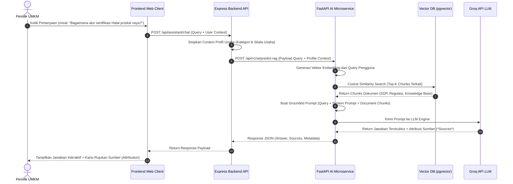
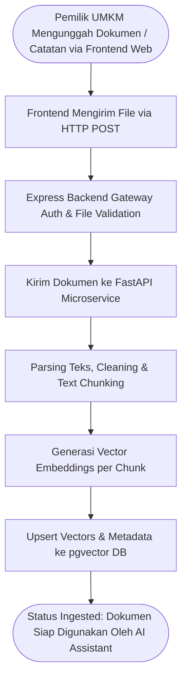

# BAB III: RANCANGAN SISTEM AND ARSITEKTUR TEKNOLOGI

---

## 3.1 Stack Teknologi (Technology Stack & Architecture)

Platform **Strategiku** (*Integrated UMKM Business Growth Intelligence Platform*) dibangun menggunakan arsitektur mikro/layanan terpisah (*decoupled architecture*) yang memisahkan antara **Frontend Client Layer**, **Backend Gateway API Layer**, **AI Microservice Engine Layer**, serta **Database & Storage Layer**. Pendekatan ini dipilih untuk menjamin skalabilitas, kecepatan pengembangan, keamanan data, serta kemudahan pemeliharaan sistem.

Berikut adalah rincian arsitektur teknologi yang digunakan dalam pengembangan sistem:

---

### Rincian Komponen Arsitektur Teknologi

#### 1. Frontend Framework & Client Layer
* **Framework**: React 19 (berbasis Vite 6 & TypeScript 5.7) untuk membangun Single Page Application (SPA) yang responsif, komparabel, dan berperforma tinggi.
* **Styling & UI Components**:
  * **Tailwind CSS v4**: Utilitas CSS modern untuk perancangan antarmuka yang cepat dan kustomisasi desain *glassmorphism* serta *dark mode*.
  * **Lucide Icons**: Library ikon vektor konsisten.
  * **Plus Jakarta Sans**: Tipografi standar modern untuk keterbacaan data bisnis.
* **State Management & Data Fetching**:
  * **TanStack React Query v5**: Mengelola status *asynchronous*, *caching*, dan re-fetching data dari server secara efisien.
  * **Axios**: HTTP Client untuk komunikasi API asynchronous.
* **Visualisasi Data & Form Validation**:
  * **Recharts v2**: Menampilkan grafik visualisasi tren omset, grafik SKU produk terlaris, dan analitik kesehatan finansial.
  * **React Hook Form + Zod**: Validasi formulir dinamis di sisi klien secara presisi.

#### 2. Backend Gateway & Core API Layer
* **Runtime & Framework**: Node.js versi LTS dengan Express.js (TypeScript) yang terstruktur modular berprinsip Clean Architecture.
* **Database Access / ORM**:
  * **Prisma ORM v5**: Pemetaan objek-relasional bertipe aman (*type-safe*) untuk PostgreSQL.
  * **Supabase JS SDK v2**: Interaksi langsung dengan layanan Supabase (Auth, RLS Policies, dan Storage).
* **Keamanan & Middleware**:
  * **JSON Web Token (JWT)** & **Bcryptjs**: Autentikasi berbasis *Bearer Token* dan enkripsi kata sandi.
  * **Helmet & CORS**: Perlindungan header HTTP dan pembatasan domain pengakses API.
  * **Express Rate Limit**: Pencegahan serangan *Brute-Force* atau *DDoS*.
* **Ingesti & Validasi Data**:
  * **Multer & csv-parse**: Memproses unggahan dan parsing berkas CSV data transaksi harian UMKM.
  * **Zod**: Validasi skema skema *request payload* HTTP secara ketat.
* **Dokumentasi API**:
  * **Swagger UI & OpenAPI 3.0** (`swagger-jsdoc`, `swagger-ui-express`): Menuntun pengembang melalui dokumentasi interaktif yang dapat diakses di `/api/docs`.

#### 3. AI Microservice Layer
* **Runtime & Framework**: Python 3.9+ dengan **FastAPI** dan server **Uvicorn**, memproses tugas komputasi AI secara terpisah (*asynchronous AI microservice*).
* **Orkestrasi RAG & Vector Engine**:
  * **LangChain / LlamaIndex**: Mengatur alur *Retrieval-Augmented Generation* (RAG), pemotongan teks (*chunking*), hingga *prompt engineering*.
  * **Embedding Model**: Mengubah dokumen SOP/Knowledge Base menjadi representasi vektor numerik (*high-dimensional embeddings*).
  * **LLM Engine**: **Groq API** (Llama 3 / Mixtral) untuk inferensi Generative AI berkecepatan tinggi berdasar konteks tanpa halusinasi (*Grounded RAG AI*).

#### 4. Database & Storage Layer
* **Relational Database (RDBMS)**: **Supabase PostgreSQL 17** yang terdiri dari 17 tabel relasional terstruktur (pengguna, profil bisnis, transaksi, produk SKU, hingga data katalog peluang bisnis Jawa Barat).
* **Vector Store**: Ekstensi **`pgvector`** pada PostgreSQL untuk menyimpan dan mengeksekusi *Cosine Similarity Search* terhadap vektor embedding dokumen bisnis.
* **Object Storage**: **Supabase Storage** untuk menyimpan file CSV mentah serta aset gambar/media pendukung.

#### 5. Cloud Infrastructure & Deployment
* **Frontend & Backend Hosting**: **Vercel Platform** (Serverless Architecture) yang terhubung dengan repositori GitHub untuk *Continuous Integration & Continuous Deployment* (CI/CD) otomatis.
* **Database Infrastructure**: **Supabase Cloud Infrastructure** berbasis PostgreSQL terkelola dengan keandalan tinggi dan dukungan RLS (*Row Level Security*).

---

## 3.2 Alur Kerja Sistem (User Flow & Flowchart)

Alur kerja sistem **Strategiku** dirancang agar intuitif dan efisien bagi pemilik UMKM. Diagram berikut menggambarkan alur perjalanan pengguna (*User Flow*) dari awal mengakses aplikasi hingga memanfaatkan tiga mesin kecerdasan (*Intelligence Engines*).

---

### 1. Diagram User Flow Utama (Global System Journey)

Diagram flowchart berikut menggambarkan siklus perjalanan pengguna secara keseluruhan dalam sistem:

---

### 2. Rincian Sub-Alur Kerja Sistem (Detailed Feature Flows)

#### A. Alur Kerja Ingesti Data & Business Intelligence (BI Engine)

Alur ini menjelaskan bagaimana data penjualan harian diolah menjadi visualisasi grafis dan rekomendasi kesehatan finansial:

**Langkah-langkah Operasional Ingesti BI:**
1. Pengguna memilih berkas CSV transaksi harian pada halaman **Business Data**.
2. Backend memvalidasi integritas data (kolom tanggal, harga, kuantitas, dan nama produk).
3. Data yang lolos validasi dimasukkan ke database PostgreSQL.
4. Engine kalkulasi memproses agregasi data dan menghasilkan *automated insights* (misal: "Produk Kopi Karawang mengalami kenaikan penjualan 18% bulan ini").
5. Frontend menampilkan hasil analitik dalam bentuk grafik Recharts interaktif.

---

#### B. Alur Kerja Opportunity Matcher Engine

Alur pencocokan program pemerintah, sertifikasi halal, dan pembiayaan dengan profil spesifik UMKM:

```mermaid
flowchart LR
    A[Start: Akses Opportunity Center] --> B[Fetch Business Profile User]
    B --> C[Query Database Peluang Terverifikasi Jabar]
    C --> D[Pencocokan Kriteria Matching Engine]

    subgraph Scoring Pipeline
        D --> D1[Filter Sektor Usaha]
        D1 --> D2[Filter Lokasi Kabupaten/Kota]
        D2 --> D3[Kalkulasi Ambang Omset & Kapasitas]
        D3 --> D4[Generate Score 0% - 100%]
    end

    D4 --> E[Urutkan Peluang Berdasarkan Score Tertinggi]
    E --> F[Tampilkan Cards Rekomendasi + Label Provenance 'Why Recommended']
    F --> G([End: User Mengakses / Mendaftar Program Peluang])
```

**Langkah-langkah Operasional Opportunity Matcher:**
1. Sistem mengambil data profil UMKM (sektor usaha, lokasi kabupaten/kota di Jawa Barat, rentang omset bulanan).
2. *Matcher Engine* membandingkan profil tersebut dengan database kriteria program (seperti Program SEHATI BPJPH, Kurasi Ekspor Disindag Jabar, atau Kredit Mesra bjb).
3. Setiap peluang dihitung skor kecocokannya (0–100%).
4. Peluang disajikan kepada pengguna lengkap dengan transparansi penjelasan (*Provenance*) mengenai alasan program tersebut direkomendasikan.

---

#### C. Alur Kerja AI Growth Assistant (Grounded RAG Flow)

Alur konsultasi bisnis bebas halusinasi yang menggunakan kombinasi data internal UMKM dan dokumen regulasi resmi:

**Langkah-langkah Operasional RAG AI Assistant:**
1. Pengguna mengajukan pertanyaan seputar operasional atau strategi bisnis melalui modul **AI Assistant**.
2. Backend melengkapi pertanyaan dengan latar belakang profil bisnis pengguna.
3. AI Microservice mengubah pertanyaan menjadi vektor numerik dan melakukan pencarian pencocokan semantik pada **`pgvector`**.
4. Potongan teks (*chunks*) dokumen yang paling relevan diambil sebagai bahan konteks.
5. LLM menyusun jawaban kontekstual dengan kewajiban melampirkan sitasi sumber (*Anti-Hallucination Guardrails*).

---

#### D. Alur Kerja Manajemen Knowledge Base (Document Upload Flow)

Alur penambahan dan pengelolaan dokumen panduan, SOP, atau catatan bisnis UMKM langsung ke dalam sistem berbasis RAG:

**Langkah-langkah Operasional Manajemen Knowledge Base:**
1. Pengguna mengunggah dokumen bisnis (PDF/Markdown/TXT) melalui menu **Knowledge Base** pada platform web Strategiku.
2. Frontend mengirimkan file ke Backend API untuk divalidasi keamanannya.
3. Dokumen diteruskan ke AI Microservice (FastAPI) untuk diekstraksi teksnya, lalu dibagi menjadi segmen-segmen kecil (*chunks*).
4. Model Embedding mengonversi *chunks* menjadi nilai vektor.
5. Vektor disimpan ke dalam `pgvector` sehingga AI Assistant dapat secara otomatis merujuk dokumen internal bisnis tersebut saat menjawab pertanyaan pengguna menggunakan model dari Groq API.
